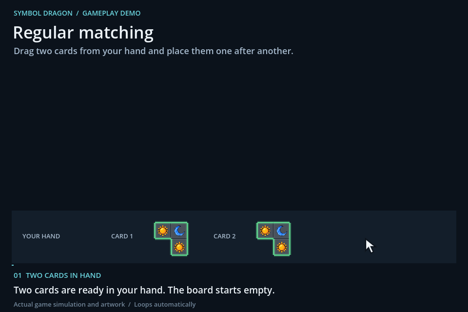
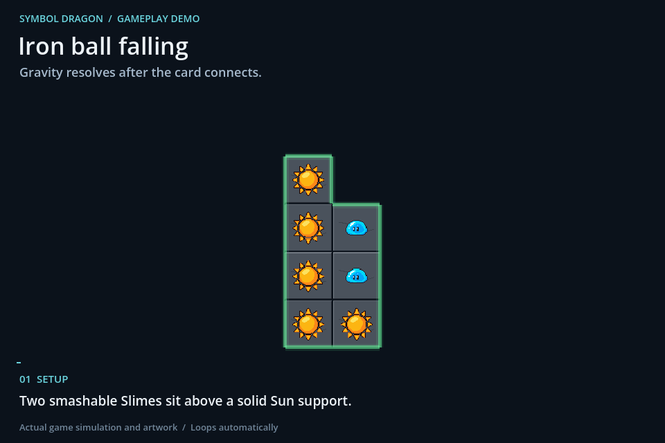
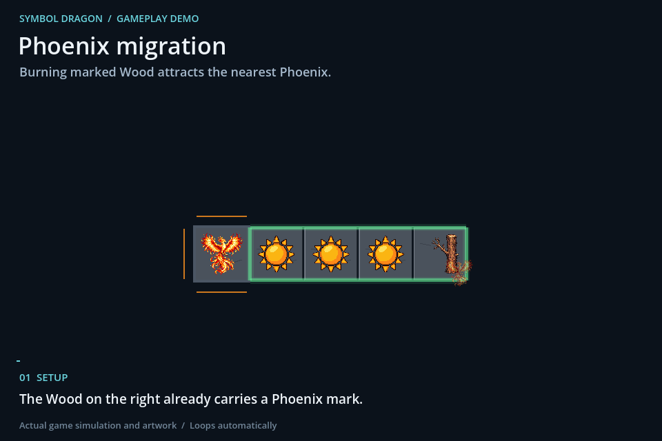
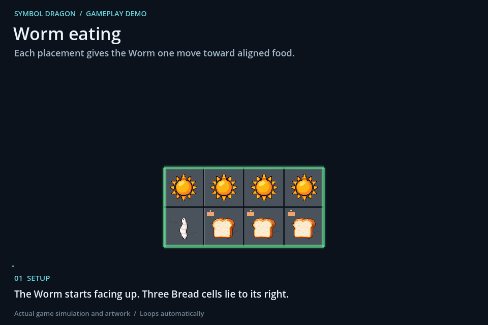
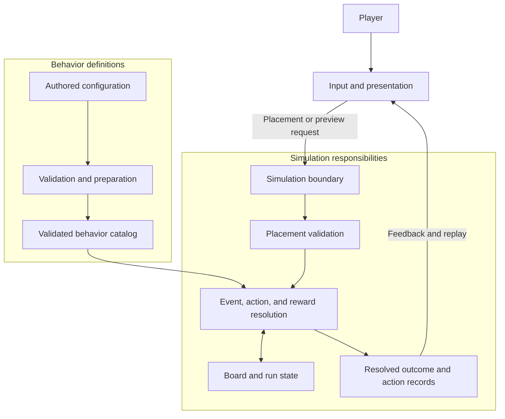
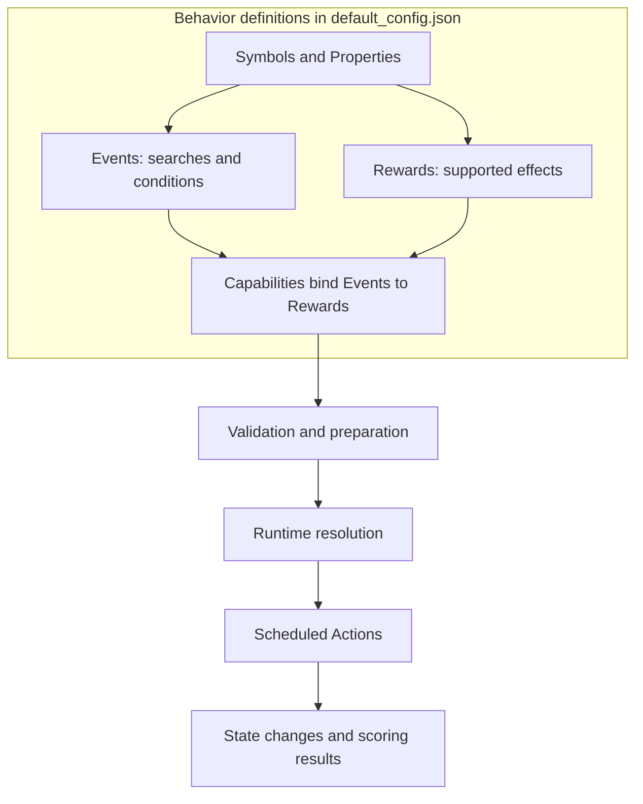
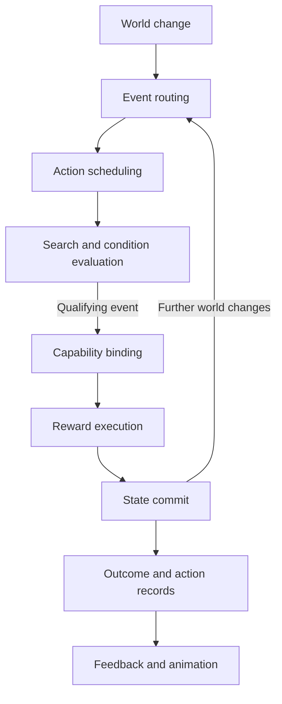

# Symbol Dragon

A grid-based tactical placement game about building patterns and discovering how symbols interact.

Place cards made of connected tiles, find useful matches, and turn a growing board into a chain of reactions. A well-placed card can do more than extend a pattern: it can set something in motion and change the opportunities around it.

The game is a Godot prototype with a playable placement core and a roguelike direction. This repository presents gameplay demonstrations and an overview of its software architecture.

## See it in motion

### Placing and matching



Drag cards onto the board and connect compatible symbols.

### Gravity and impacts



Watch a placement change the board through gravity.

### Phoenix migration



A distant interaction draws the Phoenix across the board.

### Worm eating



Each placement creates another opportunity for the Worm to move.

These looping demonstrations use the prototype's simulation, artwork, placement previews, and animation system. The cursor in the matching demonstration is choreographed for clarity.

## The game at a glance

Choose a card, adjust its orientation, and look for a useful place on the board. Compatible symbols open up placements; the arrangement you leave behind creates opportunities for later cards. Some symbols alter their surroundings, so the board develops through both deliberate placement and the reactions that follow.

The larger run connects these decisions across levels. Your deck develops as you progress, while each new board asks you to find different combinations of patterns and symbol behavior.

## System design

### Design objectives

The simulation needs to support interacting behaviors without giving each symbol a separate copy of the game's rules. It also needs to explain the result of a placement through previews and animation.

The architecture has three principal objectives:

- **Composability.** New content should combine established searches, conditions, and effects through configuration.
- **Consistency.** Placement validation, state changes, and scoring should use a common simulation model.
- **Explainability.** The interface should present the sequence of a reaction without making animation timing part of the rules.

### System boundary

The interface owns input and presentation. The simulation owns legality and the authoritative game state. Configuration supplies behavior definitions; registered engine components provide the operations those definitions can use.



The board and its entities form the shared world model. Searches inspect that model; effect handlers change it through the simulation's state-management boundary. The simulation decides which interactions are valid, and the interface displays the resolved results.

### Event, Reward, and Action model

The behavior-definition layer of `default_config.json` forms a **declarative domain-specific language (DSL)** for the simulation. JSON supplies its notation; the game's concepts supply its vocabulary and meaning. Authors describe the entities, situations, and responses that make up a behavior. The engine gives those descriptions their execution semantics.

Alongside ordinary run and presentation settings, the file brings together symbol and property definitions, spatial searches, qualifying conditions, and Event-to-Reward bindings. These constructs let content authors compose behaviors from the operations the engine supports.

| Concept | Responsibility |
| --- | --- |
| **Property** | Describes a characteristic or state associated with a game entity. |
| **Event** | Defines an occurrence or qualifying situation that the simulation can recognize. |
| **Search and condition** | Identifies relevant participants and determines whether they qualify. |
| **Capability** | Connects event definitions to rewards available in the current context. |
| **Reward** | Specifies the response to a qualifying event, such as a state change or a score contribution. |
| **Action** | Represents a scheduled unit of behavior evaluated and resolved against the current world state. |



Validation checks the definitions and their references before play. The runtime uses the prepared definitions to recognize relevant situations and schedule Actions for board-changing behavior. An Action evaluates the current state and applies the configured Rewards through registered engine operations.

Here, **reward** is an engine term for an effect. It is broader than the card choices offered between levels.

An Event describes what to recognize. A Reward describes the response. An Action gives that behavior a place in the execution sequence. State-changing rewards also produce mutation records, which let the committed result be represented consistently in the world and explained by the interface.

#### Example: Phoenix migration

This focused excerpt from `default_config.json` shows an Event declaration, a Reward definition, and the Capability that connects them. It assumes the existing participant searches, symbol definitions, and property setup from the full configuration.

```json
{
  "events": {
    "PHOENIX_MIGRATION": {
      "event_id": "PHOENIX_MIGRATION",
      "phase": "action",
      "evaluate_in_preview": false
    }
  },
  "rewards": {
    "MIGRATE_PHOENIX": {
      "type": "migrate_phoenix",
      "reward_id": "MIGRATE_PHOENIX",
      "reward_definition": {
        "sourceReplacementSymbolId": "FIRE",
        "destinationSymbolId": "FIRE",
        "phoenixesSearchResult": "phoenixes",
        "distanceMetric": "manhattan"
      }
    }
  },
  "capabilities": {
    "PHOENIX_MIGRATION": {
      "scoring": false,
      "scope": {
        "target": "global"
      },
      "intrinsic": true,
      "event_reward_pairs": [
        {
          "event": {
            "PHOENIX_MIGRATION": {}
          },
          "reward": {
            "MIGRATE_PHOENIX": {}
          }
        }
      ]
    }
  }
}
```

- **Event:** burning marked Wood produces a migration candidate. The existing Event search identifies that destination and supplies the available Phoenixes as the named result `phoenixes`. Migration is resolved during the action phase and excluded from placement previews.
- **Reward:** `MIGRATE_PHOENIX` reads that named result, chooses the nearest Phoenix by Manhattan distance, moves it onto the candidate Fire, and leaves Fire at its departure cell. The destination Fire is consumed by the migration.
- **Capability:** the binding connects `PHOENIX_MIGRATION` to `MIGRATE_PHOENIX`. The empty objects in the binding reference the registered definitions with their existing settings. This Capability is an intrinsic global behavior and does not award score.
- **Action:** the runtime schedules a turn for each candidate. When that turn runs, it evaluates the current participants and applies the Reward. Actions are runtime work created from the definitions above.

#### Example: Iron Ball gravity

This excerpt connects the Iron Ball's gravity Property to an Event, a Reward, and a Capability. It assumes the existing support-change searches and smash-handling definitions from the full configuration.

```json
{
  "symbols": {
    "IRON_BALL": {
      "properties": {
        "GRAVITY": {}
      }
    }
  },
  "properties": {
    "GRAVITY": {
      "property_id": "GRAVITY",
      "data": {
        "direction": "S"
      },
      "data_scope": "per-level"
    }
  },
  "events": {
    "GRAVITY_FALL": {
      "event_id": "GRAVITY_FALL",
      "phase": "action",
      "evaluate_in_preview": true,
      "parameters": {
        "gravityPropertyId": "GRAVITY"
      }
    }
  },
  "rewards": {
    "GRAVITY_FALL": {
      "type": "gravity_fall",
      "reward_id": "GRAVITY_FALL",
      "reward_definition": {
        "gravityPropertyId": "GRAVITY",
        "smashablePropertyId": "SMASHABLE",
        "smashedEventId": "SMASHED"
      }
    }
  },
  "capabilities": {
    "GRAVITY_SYSTEM": {
      "scoring": false,
      "scope": {
        "target": "global"
      },
      "intrinsic": true,
      "event_reward_pairs": [
        {
          "event": {
            "GRAVITY_FALL": {}
          },
          "reward": {
            "GRAVITY_FALL": {}
          }
        }
      ]
    }
  }
}
```

- **Property:** `IRON_BALL` references `GRAVITY`, which supplies the downward direction `S` and a per-level state lifecycle. The empty reference object uses the registered Property's settings.
- **Event:** `GRAVITY_FALL` identifies affected gravity cells when relevant changes may alter their support. Its `gravityPropertyId` parameter tells the existing searches which Property to look for. This Event is evaluated in placement previews.
- **Reward:** the `gravity_fall` handler resolves the acting ball's fall, removes cells marked `SMASHABLE` that it encounters, and emits `SMASHED` events. A separate scoring Capability handles those events, keeping physical effects and scoring independently configured.
- **Capability:** `GRAVITY_SYSTEM` binds the `GRAVITY_FALL` Event to the Reward of the same name. It is an intrinsic global behavior, and the gravity Capability itself does not award score.
- **Action:** each affected ball gets its own scheduled turn. When that turn runs, it checks the current board and resolves the ball to rest or off the board. A ball that remains supported stays in place.

### Resolution lifecycle

A world change can make another behavior relevant. The resolver routes that change, schedules the affected work, and evaluates it against the state left by earlier actions. A response can then produce another change and continue the chain.



Participant discovery and action evaluation are separate responsibilities. A change identifies which actors may need attention; when an actor's turn runs, it evaluates the relevant surroundings as they exist at that point. This supports interactions among behaviors without requiring one symbol to call another symbol's implementation directly.

Placement-level preparation, board-changing actions, and settled-board evaluation occupy distinct stages of resolution. Defined ordering makes cascades reproducible. Processing limits and diagnostics keep excessive chains observable and bounded.

### Configuration and engine responsibilities

Configuration is a domain-specific description of behavior. It selects participants, expresses conditions, associates Events with Rewards, and supplies content parameters. Validation checks that these definitions refer to supported concepts and can be used together.

The engine supplies the spatial operations, state transitions, scheduling, and consistency checks. Configuration composes those primitives; introducing a fundamentally new operation can require engine work.

This division makes ordinary content changes data-driven while keeping mutation and legality in a central, testable system. The configuration remains focused on the game's domain concepts.

### Previews and presentation

Placement previews evaluate the permitted prospective work in isolated state, preserving the live board. Committed placements resolve through the simulation and produce an ordered record of the outcome. The interface uses that record to show movement, impacts, transformations, and score feedback.

The simulation's result is authoritative throughout playback. Animation can explain a sequence at a readable pace without determining the logical outcome. Explicit ordering and seeded randomness support repeatable scenarios during development.

### Trade-offs

The shared resolver reduces special-case coupling between behaviors, but it makes execution order an important part of the design. Configuration increases flexibility, but it also requires validation and useful diagnostics. Keeping presentation separate from resolution makes the simulation easier to reason about, while requiring the interface to represent intermediate states faithfully.

## Development status

The current prototype includes card placement and matching, interacting symbol behaviors, placement previews, animated resolution, level progression, and deck development. The broader roguelike structure and additional content remain in development.
